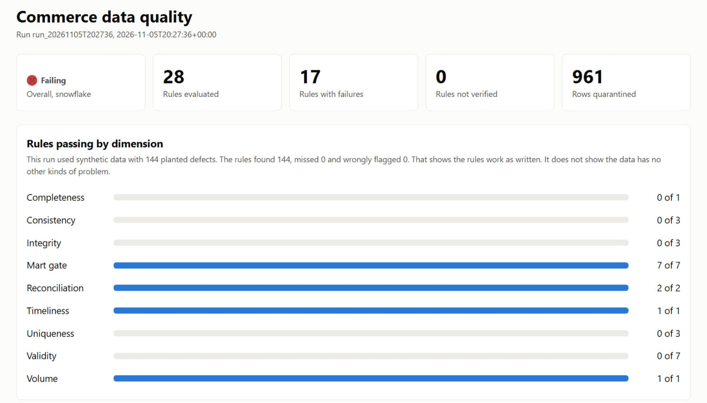
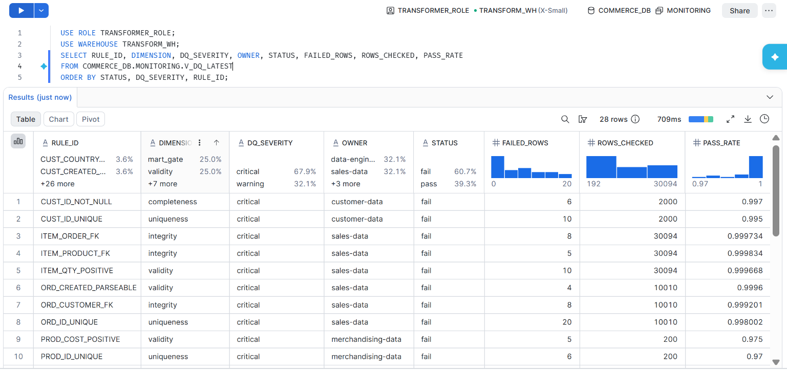
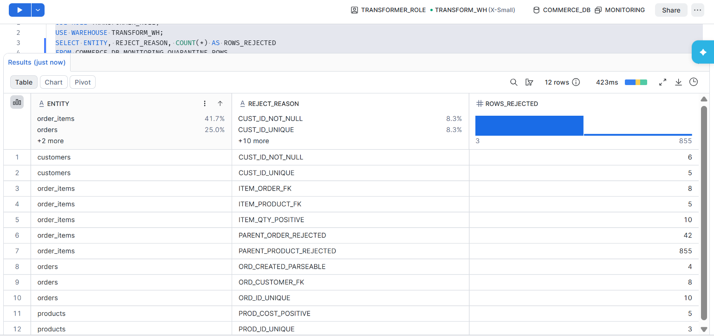
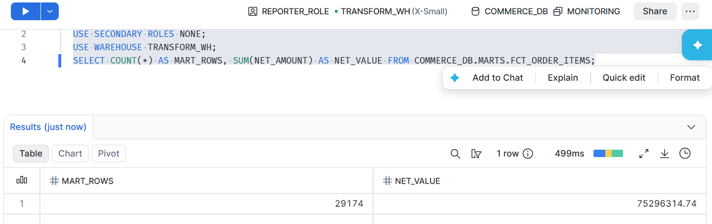
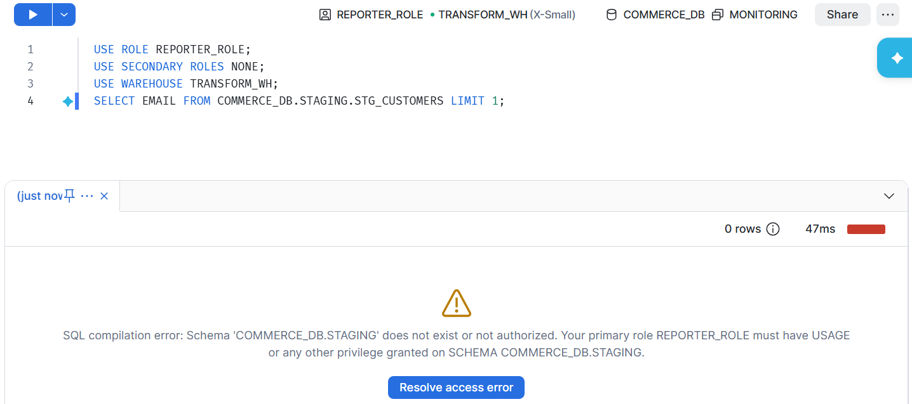
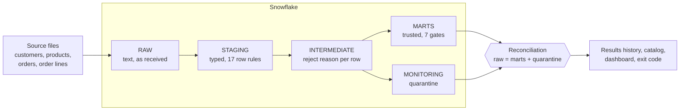

<div align="center">

# Commerce ELT Data Quality Platform

**A governed data quality framework on Snowflake and dbt, with rules that have owners, bad rows that keep their reasons, and checks that are themselves tested.**

[](https://github.com/gbadedata/commerce-elt-platform/actions/workflows/ci.yml)


[Results](#results) · [Architecture](#architecture) · [Rules](#rules) · [Governance](#governance) · [Design decisions](#design-decisions) · [Limits](#limits-and-next-steps) · [Run it](#run-it)

</div>

A pipeline that finishes has not proved its data is right. This project treats a green run as a claim that needs evidence. Each rule has an owner, a severity and a business reason. Rejected rows are kept with the rule that rejected them. A check that could not run counts as a failure, not a pass.

| 28 | 144 of 144 | 0 | 9 of 9 |
|:---:|:---:|:---:|:---:|
| rules across nine dimensions | planted defect rows found | false positives | gates and reconciliations passed on the defect run |



<sub>Dashboard from the live Snowflake run, on synthetic data with defects planted on purpose.</sub>

## Results

The same synthetic data was run on Snowflake and on DuckDB, and every rule found the same rows on both.

| Run | Snowflake | DuckDB |
|---|---|---|
| Clean data | 28 of 28 rules pass, exit code 0 | 28 of 28 rules pass, exit code 0 |
| Planted defects | 144 of 144 found, none wrongly flagged, exit code 2 | 144 of 144 found, none wrongly flagged, exit code 2 |
| Gates and reconciliation on the defect run | 9 of 9 pass | 9 of 9 pass |
| Rows quarantined on the defect run | 961 | 961 |

Exit code 2 is the correct result for the defect run, because critical defects were planted. Of the 961 quarantined rows, 855 are order lines held back because their product was rejected, so one bad parent row is not allowed to leave its children looking valid.

**A perfect score here has a narrow meaning.** I planted these defects and wrote the rules for them, so it shows the rules do what they say. It does not predict how they would perform on real data, or catch problems nobody has written a rule for.

### Evidence from the Snowflake run

Click an image to enlarge it. Also see the [row counts loaded](screenshots/snowflake/01_raw_row_counts.png) and the [full dashboard](screenshots/snowflake/06_dashboard.png).

<table>
<tr>
<td width="50%"><a href="screenshots/snowflake/02_rule_results.png"></a><br><sub><b>Rule results.</b> All 28 rules, with owner, status and failed rows.</sub></td>
<td width="50%"><a href="screenshots/snowflake/03_quarantine.png"></a><br><sub><b>Quarantine.</b> Rejected rows, grouped by the rule that rejected them.</sub></td>
</tr>
<tr>
<td width="50%"><a href="screenshots/snowflake/04_reporter_reads_mart.png"></a><br><sub><b>Allowed.</b> The reporting role reads the trusted mart.</sub></td>
<td width="50%"><a href="screenshots/snowflake/05_reporter_denied_staging.png"></a><br><sub><b>Refused.</b> The same role cannot read staging, where personal data lives.</sub></td>
</tr>
</table>

## Architecture



| Layer | What happens | Who can read it |
|---|---|---|
| **RAW** | Rows load as text with a batch ID, so a malformed value becomes a finding and not a failed load | Loader and transformer |
| **STAGING** | Values are typed safely, and row rules run. This is the last layer with personal data | Transformer only |
| **INTERMEDIATE** | Each row gets a reject reason or none, and duplicates keep the first record received | Transformer only |
| **MARTS** | Only accepted rows, with no personal data. Gates must pass here | Transformer and reporting |
| **MONITORING** | Quarantine, failure tables holding row IDs only, results history and a latest-results view | Transformer and reporting |

### What happens to one bad row

Take an order line that arrives with a quantity of `-2`.

1. It loads into `RAW` as text, like every other row.
2. `ITEM_QTY_POSITIVE` flags its row ID in staging.
3. `int_order_items_checked` gives it the reject reason `ITEM_QTY_POSITIVE`.
4. It stays out of `fct_order_items` and appears in `quarantine_rows`.
5. `RECON_ROW_COUNTS` and `RECON_ORDER_VALUE` confirm that it, and its value, are still accounted for.
6. The result is recorded against the owner, `sales-data`, and appears on the dashboard. As the rule is critical, the run exits with code 2 for a scheduler to act on.

## Rules

| Dimension | Rules | Example |
|---|---:|---|
| Completeness | 1 | Every customer record has a customer ID |
| Uniqueness | 3 | An order ID belongs to only one record |
| Validity | 7 | A sold quantity is above zero |
| Consistency | 3 | A discount does not exceed the unit price |
| Integrity | 3 | An order line points to a received product |
| Timeliness | 1 | The latest raw batch arrived within the agreed window |
| Volume | 1 | An order batch has at least the expected number of rows |
| Reconciliation | 2 | Raw rows equal mart rows plus quarantined rows |
| Mart gates | 7 | The fact table has no duplicate order lines |

<details>
<summary><b>See all 28 rules</b></summary>

| Rule | Dimension | Severity | Owner | What it checks |
|---|---|---|---|---|
| `CUST_ID_NOT_NULL` | Completeness | Critical | customer-data | Every customer record has a customer ID. |
| `CUST_ID_UNIQUE` | Uniqueness | Critical | customer-data | A customer ID belongs to only one record. |
| `ORD_ID_UNIQUE` | Uniqueness | Critical | sales-data | An order ID belongs to only one record. |
| `PROD_ID_UNIQUE` | Uniqueness | Critical | merchandising-data | A product ID belongs to only one record. |
| `CUST_COUNTRY_ACCEPTED` | Validity | Warning | customer-data | Country is one of the markets served. |
| `CUST_CREATED_NOT_FUTURE` | Validity | Warning | customer-data | A customer cannot be created in the future. |
| `CUST_EMAIL_FORMAT` | Validity | Warning | customer-data | Email addresses have a valid basic format. |
| `ITEM_QTY_POSITIVE` | Validity | Critical | sales-data | A sold quantity is above zero. |
| `ORD_CREATED_PARSEABLE` | Validity | Critical | sales-data | The order date can be read as a timestamp. |
| `ORD_STATUS_ACCEPTED` | Validity | Warning | sales-data | Status is a known lifecycle state. |
| `PROD_COST_POSITIVE` | Validity | Critical | merchandising-data | A product has a cost above zero, or margin cannot be calculated. |
| `ITEM_DISCOUNT_LE_PRICE` | Consistency | Warning | finance-data | A discount does not exceed the unit price. |
| `ORD_UPDATED_AFTER_CREATED` | Consistency | Warning | sales-data | An order is not updated before it was created. |
| `PROD_PRICE_GE_COST` | Consistency | Warning | merchandising-data | List price is not below cost. |
| `ITEM_ORDER_FK` | Integrity | Critical | sales-data | An order line points to a received order. |
| `ITEM_PRODUCT_FK` | Integrity | Critical | sales-data | An order line points to a received product. |
| `ORD_CUSTOMER_FK` | Integrity | Critical | sales-data | An order customer exists in the customer feed. |
| `FRESH_RAW_LOAD` | Timeliness | Warning | data-engineering | The latest raw batch arrived within the agreed window. |
| `ORD_MIN_VOLUME` | Volume | Warning | sales-data | An order batch has at least the expected number of rows. |
| `RECON_ORDER_VALUE` | Reconciliation | Critical | finance-data | Net value in the fact table plus quarantined value equals the value received, within 0.01. |
| `RECON_ROW_COUNTS` | Reconciliation | Critical | data-engineering | Every raw row ends up in a mart or in quarantine, so no row is lost silently. |
| `GATE_DIM_CUSTOMER_KEY_NOT_NULL` | Mart gate | Critical | data-engineering | The customer dimension has no null keys. |
| `GATE_DIM_CUSTOMER_KEY_UNIQUE` | Mart gate | Critical | data-engineering | The customer dimension has no duplicate keys. |
| `GATE_DIM_PRODUCT_KEY_NOT_NULL` | Mart gate | Critical | data-engineering | The product dimension has no null keys. |
| `GATE_DIM_PRODUCT_KEY_UNIQUE` | Mart gate | Critical | data-engineering | The product dimension has no duplicate keys. |
| `GATE_FCT_CUSTOMER_FK` | Mart gate | Critical | data-engineering | Every named customer on a fact row is trusted. |
| `GATE_FCT_ITEM_KEY_UNIQUE` | Mart gate | Critical | data-engineering | The fact table has no duplicate order lines. |
| `GATE_FCT_PRODUCT_FK` | Mart gate | Critical | data-engineering | Every fact row has a trusted product. |

</details>

**Severity decides what happens.** Warning rules flag rows and let them through, so a questionable but usable value does not hold up reporting. Critical row rules send rows to quarantine. Mart gates and reconciliation fail the dbt run, because a broken key or a lost row should stop people trusting a table.

| Exit code | Status | Meaning |
|---:|---|---|
| 0 | `HEALTHY` | Every rule ran and passed |
| 1 | `WARN` | Warning rules failed |
| 2 | `FAIL` | A critical rule failed, or a rule could not be verified |

## Testing the checks

The generator plants defects and writes down the affected rows in a separate manifest. `scripts/evaluate_rules.py` then compares what each rule caught with what was planted, rule by rule.

A check is only worth trusting once it has been seen failing, so the 19 automated tests also break things on purpose:

- insert a duplicate into a mart, and the gate must fail
- delete a fact row, and both reconciliations must fail
- simulate a stale load and a low order volume, and those rules must fire
- remove dbt's results file, and every rule must report as unverified
- tamper with the manifest, and the evaluation must report a miss and a false alarm

This found a real bug. My first order value reconciliation read an intermediate model instead of the fact table, so it could never fail. Deleting a fact row exposed it, and it now reads the table it claims to check.

The tests run in [GitHub Actions](https://github.com/gbadedata/commerce-elt-platform/actions/workflows/ci.yml) on every push, using DuckDB and no secrets.

## Governance

- **Ownership:** every rule and model has a named owner, and a test fails if the catalog shows a model without one.
- **Definitions:** a [business glossary](governance/business_glossary.yml) defines terms such as Net Order Value and Quarantined Row. A test fails if a term points at a column that does not exist.
- **Lineage and metadata:** the [data catalog](docs/data_catalog.md) is generated from dbt metadata, with upstream and downstream models, grain and personal data flags, so it changes with the code.
- **Personal data:** columns are tagged in the model metadata. A test fails if any tagged column appears in marts or monitoring tables.
- **Access:** separate load, transform and reporting roles. The service user signs in with a key pair and has secondary roles switched off. Snowflake turns those on by default for new users, which would let each step use every role the user holds.

## Design decisions

| Decision | Why | Trade-off |
|---|---|---|
| Keep raw data as text | A bad value becomes a visible finding, not a failed load that hides the row | Typing work moves to staging |
| Warn on row rules, stop at marts | One bad source row should not halt all reporting, but a broken mart should not be trusted | Warned rows reach marts until the owner acts |
| Quarantine instead of dropping | Every rejected row stays countable and explainable | Someone has to own the queue |
| Treat unverified as failed | A check that did not run proves nothing | Platform problems look like data failures until investigated |
| Hold back children of rejected parents | An order line for a rejected product cannot be reported reliably | One bad product can quarantine many lines |
| Test in CI on DuckDB | Fast, free and needs no secrets | Cannot catch Snowflake differences, which is why it also ran live, with engine-specific SQL kept in macros |

## Limits and next steps

This is a portfolio project on synthetic data, not a production system.

- **Scale:** about 42,000 rows on one extra-small warehouse. Performance at volume is untested.
- **Loading:** each run replaces the raw tables and rebuilds the models. Production would need incremental loads.
- **Scheduling:** runs are started by hand. The exit codes are ready for a scheduler, but none is set up.
- **Alerting:** the Snowflake alert in `sql/monitoring/dq_alert.sql` is written but has not been run.
- **Replay:** quarantined rows are explained and counted, but there is no automated way to replay them after a fix.
- **Thresholds and owners:** these are illustrative. Real ones would be agreed with the business.
- **S3 route:** `sql/setup/03` and `04` are from an earlier S3 setup that this flow does not use.

## Run it

**Locally, with no account.** Needs Python 3.11 or later.

```bash
python -m venv .venv && source .venv/bin/activate
pip install -r requirements.txt

python scripts/run_pipeline.py --mode clean      # exit code 0
python scripts/run_pipeline.py --mode defects    # exit code 2, on purpose
pytest -q
```

Then open `reports/dq_dashboard.html`.

**On Snowflake.** Follow [the runbook](docs/RUNBOOK_SNOWFLAKE.md), which covers the trial account, key pair, setup SQL and evidence queries. Warehouses suspend after 30 seconds, and a resource monitor sets a limit of 5 credits.

## Repository layout

```text
commerce_dbt/      Models, rule macros, reconciliation and freshness tests
scripts/           Generator, loader, results publisher, evaluation, catalog, dashboard, health check
governance/        Business glossary
docs/              Generated data catalog and Snowflake runbook
sql/setup/         Database, roles, warehouses and service user
sql/monitoring/    Snowflake alert and evidence queries
tests/             End-to-end tests, run in CI
screenshots/       Evidence from the Snowflake run
```

---

Built by **Oluwagbade Odimayo** · [Portfolio](https://gbadedata.com) · [LinkedIn](https://www.linkedin.com/in/oluwagbade-odimayo-)
