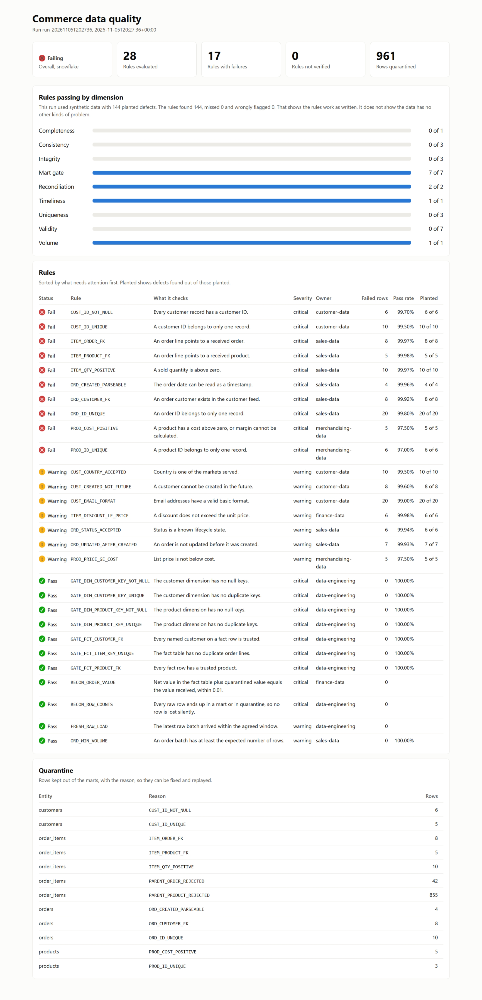
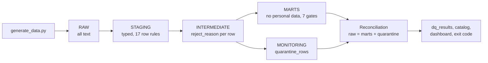

# Commerce ELT data quality platform

A data quality and governance framework for a commerce warehouse, built with dbt and run on Snowflake.

Every rule has an owner, a severity and a business reason. Bad rows are quarantined with the rule that rejected them. Tables are only trusted after their gates pass. A rule that could not run counts as a failure, because a check that did not run proves nothing.



## Status

| What | State |
|---|---|
| Rules, quarantine, reconciliation, catalog and dashboard | Working on Snowflake and on DuckDB |
| Run on a live Snowflake account | Done on a trial account on 5 November 2026. [Results below](#snowflake-run) |
| End-to-end tests | Run on DuckDB, in CI on every push, with no secrets |
| Snowflake alert in `sql/monitoring/dq_alert.sql` | Written, not yet run |

The data is synthetic. No real customer or business data is involved.

## How it works



- **Raw stays text.** A malformed value becomes a finding in staging, rather than a failed load that hides the row.
- **Staging rules warn, mart gates stop.** A bad source row should not halt every report. A duplicate key in a mart should.
- **Nothing disappears.** Every raw row ends up in a mart or in quarantine, and a reconciliation test checks both row counts and order value.
- **Personal data stops at staging.** Failure tables store only row IDs. Marts carry no email or names, and the reporting role cannot read staging.
- **Exit codes:** `0` healthy, `1` warnings, `2` critical failure or unverified rule, so a scheduler can alert on the result.

## Rules

There are 28 rules across completeness, uniqueness, validity, consistency, integrity, timeliness, volume and reconciliation. Thresholds are dbt variables, and rule metadata lives next to each test in the model YAML.

See [the data catalog](docs/data_catalog.md) for owners, definitions, lineage, personal data flags and the business glossary. It is generated from dbt metadata, so it changes with the code.

## How the rules were tested

The generator plants known defects and writes a manifest of the affected rows, separately from the rules. `scripts/evaluate_rules.py` then compares what each rule caught with what was planted.

| Run on DuckDB, seed 42 | Result |
|---|---|
| Clean data | 28 of 28 rules pass, nothing quarantined, exit code 0 |
| Planted defects | 144 of 144 rows found across 17 rules, no false positives, exit code 2 |
| Gates and reconciliation on the defect run | All 9 pass, so the bad rows stayed out of the marts |

The tests also damage things on purpose, because a check is only worth trusting once it has been seen failing: a duplicate inserted into a mart, a row deleted from the fact table, a stale load, a low order volume, and a dbt run with missing results.

That testing paid for itself. The first version of the order value reconciliation read an intermediate model instead of the fact table, so it could never fail. Deleting a fact row exposed it, and it is fixed.

**What this does not show.** The planted defects are ones I knew to write rules for, so the perfect score shows the rules do what they say. It does not measure how they would do on real data, or catch problem types nobody has written a rule for. The volumes are small, and the thresholds and owners are illustrative. Real ones would be agreed with the business.

## Snowflake run

Run on a Snowflake trial account with key-pair sign-in, an extra-small warehouse and the same synthetic data. The rule results matched the DuckDB run row for row.

| Check | Result |
|---|---|
| Data loaded with `PUT` and `COPY INTO` | [2,000 customers, 200 products, 10,010 orders, 30,094 order lines](screenshots/snowflake/01_raw_row_counts.png) |
| Planted defects | [144 of 144 rows found across 17 rules](screenshots/snowflake/02_rule_results.png), no false positives |
| Gates and reconciliation | All 9 pass, with [961 rows quarantined by reason](screenshots/snowflake/03_quarantine.png) |
| Reporting role reads the mart | [29,174 rows](screenshots/snowflake/04_reporter_reads_mart.png) |
| Reporting role reads staging, where personal data lives | [Refused](screenshots/snowflake/05_reporter_denied_staging.png), which is the intended result |

The service user runs with secondary roles switched off, so loading and transforming each use one role only. Snowflake turns those on by default for new users, which would have blurred the separation and could have made the access test meaningless.

## Run it

Needs Python 3.11 or later. No Snowflake account is needed for the local run.

```bash
python -m venv .venv && source .venv/bin/activate
pip install -r requirements.txt

python scripts/run_pipeline.py --mode clean      # exit code 0
python scripts/run_pipeline.py --mode defects    # exit code 2, on purpose
pytest -q
```

Then open `reports/dq_dashboard.html`. To run on Snowflake, follow [the runbook](docs/RUNBOOK_SNOWFLAKE.md).

## Layout

| Path | Contents |
|---|---|
| `commerce_dbt/` | Models, generic rule macros, reconciliation and freshness tests |
| `scripts/` | Generator, loader, results publisher, rule evaluation, catalog, dashboard, health check |
| `governance/` | Business glossary |
| `sql/setup/` | Snowflake database, role-based access, service user. Files `03` and `04` are an earlier S3 route that this flow does not use |
| `sql/monitoring/` | Snowflake alert and evidence queries |
| `tests/` | End-to-end tests, run in CI with no secrets |
