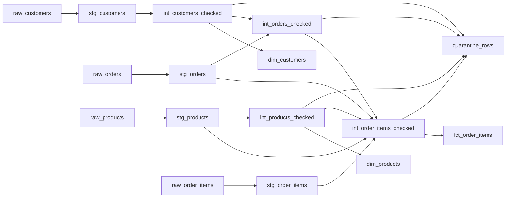

# Data catalog

Generated by `scripts/export_catalog.py` from dbt metadata. Do not edit by hand.

## Business glossary

| Term | Definition | Owner | Location |
|---|---|---|---|
| Net Order Value | Quantity multiplied by unit price, less the discount, for one order line. | finance-data | `fct_order_items.net_amount` |
| Guest Checkout | An order placed without a customer account. An empty customer ID is valid here and is not a defect. | sales-data | `fct_order_items.customer_id` |
| Trusted Customer | A customer record with a non-null ID, keeping the first record received when an ID repeats. | customer-data | `dim_customers.customer_id` |
| Trusted Product | A product with a unique ID and a cost above zero. | merchandising-data | `dim_products.product_id` |
| Quarantined Row | A received row kept out of marts, stored with the rule that rejected it so that it can be fixed and replayed. | data-engineering | `quarantine_rows.reject_reason` |

## Lineage

## Models

### dim_customers

Customers trusted for reporting. Personal data is excluded.

- **Schema:** marts
- **Owner:** customer-data
- **Grain:** One row per customer
- **Contains personal data:** no
- **Upstream:** `int_customers_checked`
- **Downstream:** none
- **Consumers:** Sales reporting
- **Rules:** `GATE_DIM_CUSTOMER_KEY_NOT_NULL`, `GATE_DIM_CUSTOMER_KEY_UNIQUE`

| Column | Description | Personal data |
|---|---|---|
| `customer_id` | Unique customer key. |  |
| `country` | ISO country code. |  |
| `created_at` | When the customer was created, in UTC. |  |

### dim_products

Products trusted for reporting.

- **Schema:** marts
- **Owner:** merchandising-data
- **Grain:** One row per product
- **Contains personal data:** no
- **Upstream:** `int_products_checked`
- **Downstream:** none
- **Consumers:** Sales reporting
- **Rules:** `GATE_DIM_PRODUCT_KEY_NOT_NULL`, `GATE_DIM_PRODUCT_KEY_UNIQUE`

| Column | Description | Personal data |
|---|---|---|
| `product_id` | Unique product key. |  |
| `cost_price` | Unit cost to the business. |  |
| `list_price` | Unit price before discount. |  |

### fct_order_items

Order lines trusted for revenue reporting.

- **Schema:** marts
- **Owner:** finance-data
- **Grain:** One row per order line
- **Contains personal data:** no
- **Upstream:** `int_order_items_checked`
- **Downstream:** none
- **Consumers:** Sales reporting, Finance reconciliation
- **Rules:** `GATE_FCT_CUSTOMER_FK`, `GATE_FCT_ITEM_KEY_UNIQUE`, `GATE_FCT_PRODUCT_FK`

| Column | Description | Personal data |
|---|---|---|
| `order_item_id` | Unique order line key. |  |
| `product_id` | Product sold. |  |
| `customer_id` | Customer, empty for a guest checkout. |  |
| `net_amount` | Quantity times unit price, less discount. |  |

### quarantine_rows

Every rejected row with the rule that rejected it.

- **Schema:** monitoring
- **Owner:** data-engineering
- **Grain:** One row per rejected source row
- **Contains personal data:** no
- **Upstream:** `int_customers_checked`, `int_products_checked`, `int_orders_checked`, `int_order_items_checked`
- **Downstream:** none

| Column | Description | Personal data |
|---|---|---|
| `entity` | Source entity. |  |
| `src_row_id` | Row identifier from the source feed. |  |
| `reject_reason` | Rule that rejected the row. |  |

### int_customers_checked

Customers with a reject reason applied.

- **Schema:** intermediate
- **Owner:** customer-data
- **Grain:** One row per received customer record
- **Contains personal data:** yes
- **Upstream:** `stg_customers`
- **Downstream:** `dim_customers`, `int_orders_checked`, `quarantine_rows`

### int_order_items_checked

Order lines with a reject reason applied, including rejected parents.

- **Schema:** intermediate
- **Owner:** sales-data
- **Grain:** One row per received order line
- **Contains personal data:** no
- **Upstream:** `stg_orders`, `stg_products`, `int_orders_checked`, `int_products_checked`, `stg_order_items`
- **Downstream:** `fct_order_items`, `quarantine_rows`

### int_orders_checked

Orders with a reject reason applied.

- **Schema:** intermediate
- **Owner:** sales-data
- **Grain:** One row per received order record
- **Contains personal data:** no
- **Upstream:** `stg_orders`, `int_customers_checked`
- **Downstream:** `int_order_items_checked`, `quarantine_rows`

### int_products_checked

Products with a reject reason applied.

- **Schema:** intermediate
- **Owner:** merchandising-data
- **Grain:** One row per received product record
- **Contains personal data:** no
- **Upstream:** `stg_products`
- **Downstream:** `dim_products`, `int_order_items_checked`, `quarantine_rows`

### stg_customers

Customer records, typed but not filtered. Contains personal data, so it is not exposed to reporting roles.

- **Schema:** staging
- **Owner:** customer-data
- **Grain:** One row per received customer record
- **Contains personal data:** yes
- **Upstream:** `raw.customers`
- **Downstream:** `int_customers_checked`
- **Rules:** `CUST_COUNTRY_ACCEPTED`, `CUST_CREATED_NOT_FUTURE`, `CUST_EMAIL_FORMAT`, `CUST_ID_NOT_NULL`, `CUST_ID_UNIQUE`

| Column | Description | Personal data |
|---|---|---|
| `src_row_id` | Row identifier from the source feed, used to trace any finding back to its record. |  |
| `customer_id` | Business key for a customer. |  |
| `email` | Contact email address. | yes |
| `first_name` | Given name. | yes |
| `last_name` | Family name. | yes |
| `country` | ISO country code. |  |

### stg_order_items

Order lines, typed but not filtered.

- **Schema:** staging
- **Owner:** sales-data
- **Grain:** One row per received order line
- **Contains personal data:** no
- **Upstream:** `raw.order_items`
- **Downstream:** `int_order_items_checked`
- **Rules:** `ITEM_DISCOUNT_LE_PRICE`, `ITEM_ORDER_FK`, `ITEM_PRODUCT_FK`, `ITEM_QTY_POSITIVE`

| Column | Description | Personal data |
|---|---|---|
| `src_row_id` | Row identifier from the source feed. |  |
| `order_id` | Parent order. |  |
| `product_id` | Product sold. |  |

### stg_orders

Order records, typed but not filtered.

- **Schema:** staging
- **Owner:** sales-data
- **Grain:** One row per received order record
- **Contains personal data:** no
- **Upstream:** `raw.orders`
- **Downstream:** `int_order_items_checked`, `int_orders_checked`
- **Rules:** `ORD_CREATED_PARSEABLE`, `ORD_CUSTOMER_FK`, `ORD_ID_UNIQUE`, `ORD_MIN_VOLUME`, `ORD_STATUS_ACCEPTED`, `ORD_UPDATED_AFTER_CREATED`

| Column | Description | Personal data |
|---|---|---|
| `src_row_id` | Row identifier from the source feed. |  |
| `order_id` | Business key for an order. |  |
| `customer_id` | Customer who placed the order. Empty for a guest checkout, which is valid. |  |
| `status` | Order lifecycle status. |  |

### stg_products

Product records, typed but not filtered.

- **Schema:** staging
- **Owner:** merchandising-data
- **Grain:** One row per received product record
- **Contains personal data:** no
- **Upstream:** `raw.products`
- **Downstream:** `int_order_items_checked`, `int_products_checked`
- **Rules:** `PROD_COST_POSITIVE`, `PROD_ID_UNIQUE`, `PROD_PRICE_GE_COST`

| Column | Description | Personal data |
|---|---|---|
| `src_row_id` | Row identifier from the source feed. |  |
| `product_id` | Business key for a product. |  |
| `cost_price` | Unit cost to the business. |  |
| `list_price` | Unit price before discount. |  |
